# Process flow — 0001-fix-delete-branch-toggle

Feature-aware planning flow for THIS run. The prototype was already on the
branch, so planning validates it instead of redoing it.

```mermaid
flowchart TD
    WS[Orchestrator: worktree .worktrees/prdash.fix-delete-branch-toggle<br/>branch fix/delete-branch-toggle · tip 4e3fb8f] --> IDX{Index fresh?}
    IDX -->|stale: at 9252700| EXP[codebase-explorer<br/>refresh codebase-index/prdash + codegraph init/sync]
    IDX -->|fresh| STATE
    EXP --> STATE[Recover state from Engram<br/>swe/prdash/delete-branch-toggle/state]
    STATE --> BRIEF[Read prototype-brief.md<br/>prototype 4e3fb8f is the starting point]
    BRIEF --> ISS[idea-refiner -> issue.md]
    ISS --> CP1{{CHECKPOINT issue}}
    CP1 -->|approved: keep compact label,<br/>no 'request' rename| BA

    subgraph BA [brainstormer ∥ architect — current change]
        BS[brainstormer: edge matrix,<br/>missing tests, clipping risk]
        AR[architect: model.Item home ·<br/>deleteLabel stays TUI copy ·<br/>adr_required=false · no migration]
    end

    BA --> BHV[Write behavior.feature<br/>caveat only for GitHub+policy ON+request no]
    BHV --> CP2{{CHECKPOINT behavior}}
    CP2 -->|approved| PLAN[Write plan.md<br/>adr_required:false · 9 scenario rows]
    PLAN --> CP3{{CHECKPOINT plan}}
    CP3 -->|approved| CTX[codebase-researcher -> context.md<br/>files/symbols/lines · contracts · mandatory boundary tests]
    CTX --> DIA[Diagrams: feature-flow + process-flow]
    DIA --> COMMIT[Commit: chore: add delete-branch-toggle plan]
    COMMIT --> EXEC[Hand off to swe-executor<br/>validate prototype · add boundary + GitLab + geometry tests ·<br/>README + CHANGELOG · gates · PR]

    EXEC -.->|OUT-OF-ENV, orchestrator-owned| SKILL[Update global skill<br/>~/.agents/skills/prdash/SKILL.md]
    EXEC --> RISK{{Mutation gate}}:::risk
    RISK -->|killed or allowlisted| DONE[PR to main]

    classDef risk fill:#ffe6e6,stroke:#c00;
    class CP1,CP2,CP3 checkpoint;
```

Decisions recorded for this change: `adr_required: false` (ADR 0013 already
exists; scope is coherence), state stays on `model.Item`, `deleteLabel` remains
a pure TUI copy helper, GitLab untouched, unknown ≠ off.
